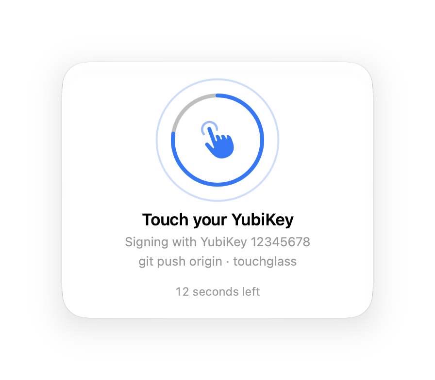
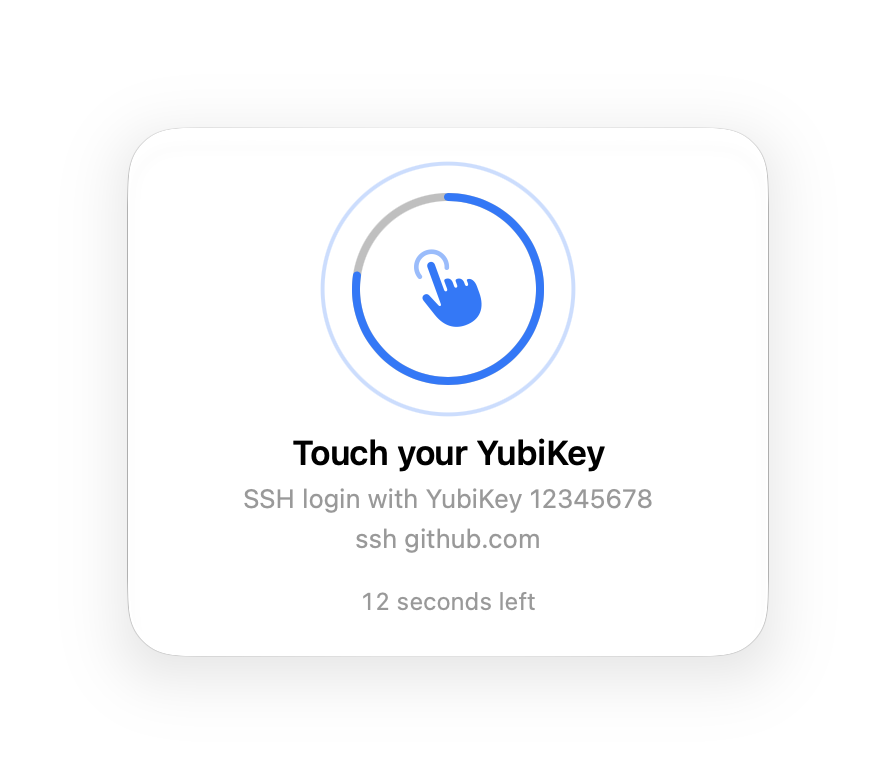

# TouchGlass

TouchGlass is a macOS panel for YubiKey operations through gpg-agent. When a signature, SSH login or decryption needs the card, one floating Liquid Glass panel asks for the PIN, then shows "Touch your YubiKey" with a countdown to the card's touch timeout, then confirms and closes itself.

Run without arguments, the app is the host: it listens on a Unix socket for `touchglass-pinentry` and `touchglass-scdaemon` and shows the panel for their prompts and card operations. To connect the helpers to gpg-agent, see [Install](#install).

## Screenshots

<p>
<picture><source media="(prefers-color-scheme: dark)" srcset="docs/images/pin-entry-dark.png"></picture>
<picture><source media="(prefers-color-scheme: dark)" srcset="docs/images/touch-dark.png"></picture>
</p>
<p>
<picture><source media="(prefers-color-scheme: dark)" srcset="docs/images/ssh-dark.png"></picture>
<picture><source media="(prefers-color-scheme: dark)" srcset="docs/images/success-dark.png"></picture>
</p>

The images follow your light or dark appearance. To capture them again, run `scripts/screenshots.sh`; see [Capture screenshots](#capture-screenshots).

## Requirements

TouchGlass runs on macOS 26 or later, on Apple silicon and Intel Macs, with GnuPG's gpg-agent.

To build it, you need Swift 6 with the macOS 26 SDK or later. The Command Line Tools are enough; Xcode is not required.

## Install with Homebrew

```sh
brew install ambroos/touchglass/touchglass
touchglass install
```

The formula installs `TouchGlass.app` in Homebrew's prefix, at `$(brew --prefix)/opt/touchglass/TouchGlass.app`, and puts the `touchglass` command, which is `scripts/touchglass` bundled in the app, on `PATH`. It also installs `gnupg` and `pinentry-mac`. Run from the app, `touchglass install` uses that app where it is instead of copying it; the rest of [Install](#install) applies. `brew upgrade touchglass` needs no new `touchglass install`, because the launchers point at the `opt` path, which follows upgrades. The running host notices the first helper of the new version and quits after it has nothing to show, so the next prompt starts the new one. Before `brew uninstall touchglass`, run `touchglass uninstall`.

Without Homebrew, download the signed and notarized `TouchGlass-<version>.zip` from the GitHub release, which runs on Apple silicon and Intel Macs, move `TouchGlass.app` to `/Applications`, and run `/Applications/TouchGlass.app/Contents/Resources/touchglass install`.

## Build

```sh
scripts/build-app.sh
```

The script builds `build/TouchGlass.app` with Swift Package Manager and signs it ad hoc. The app has no Dock icon. Pass `debug` to build the debug configuration. `--prebuilt <directory>` bundles the executables from an earlier `swift build` instead of building, as the Homebrew formula does. `TOUCHGLASS_VERSION` sets the version in `Info.plist` and in `touchglass --version`.

To run the unit tests:

```sh
scripts/test.sh
```

The script passes the Swift Testing macro plugin path to `swift test`, because with only the Command Line Tools installed the build sometimes fails to find that plugin.

## Install

`scripts/touchglass install` sets TouchGlass up and prints the change to make in `gpg-agent.conf`. It doesn't edit `gpg-agent.conf` or stop anything:

```sh
scripts/touchglass install
```

Install does the following:

1. Builds `build/TouchGlass.app` if it is missing or older than the sources, and copies it to `~/Applications`. To install somewhere else, pass `--app-dir <directory>`; to install a bundle you built yourself, pass `--from <path to TouchGlass.app>`.
2. Writes the path of the real scdaemon to `~/Library/Application Support/TouchGlass/scdaemon-program`. The path comes from the `scdaemon-program` line that `gpg-agent.conf` had before TouchGlass, else from an earlier install, else from `gpgconf --list-components`. For Homebrew, install prefers a stable path such as `/opt/homebrew/opt/gnupg/libexec/scdaemon` over the versioned `Cellar` path, which a GnuPG upgrade removes.
3. If `~/Library/Application Support/TouchGlass/pinentry.conf` doesn't exist, writes it with `fallback-pinentry` set to the pinentry that `gpg-agent.conf` named before, else `pinentry-mac`, else the pinentry that `gpgconf --list-components` reports. `touchglass-pinentry` hands prompts to that pinentry when the TouchGlass host isn't reachable. A pinentry that `gpg-agent.conf` names but that doesn't exist doesn't count. If install finds no pinentry at all, it warns and leaves the setting out. On a later install, it replaces a `fallback-pinentry` that no longer exists and keeps one that works.
4. Writes two launchers, `touchglass-pinentry` and `touchglass-scdaemon`, to `~/Library/Application Support/TouchGlass/bin`, and copies the `touchglass` command next to them. Each launcher runs the helper of the same name in the app with `exec`. While the app is missing, for example during `brew upgrade`, the pinentry launcher runs the `fallback-pinentry`, else `pinentry-mac`, else `pinentry` from Homebrew, and the scdaemon launcher runs the real scdaemon, so card operations keep working without the panel. Install rewrites the launchers each time.
5. Prints the lines to change in `gpg-agent.conf`, which is in `GNUPGHOME` if it is set and in `~/.gnupg` otherwise: the same edit that `--apply` makes, described in the next paragraph. Each effective `pinentry-program` and `scdaemon-program` line becomes a `# touchglass: ` comment followed by the line that names the launcher, and an option that isn't set gets a `# touchglass: added <option>` line before the launcher line. These comments let both uninstall modes restore the file. If `gpg-agent.conf` names the helpers inside `TouchGlass.app` directly, as installs before the launchers did, it prints those lines with their replacements instead.
6. Prints the command that makes gpg-agent read the file: `gpgconf --kill gpg-agent`. gpg-agent starts again on next use. It forgets its cached PINs and passphrases, so the next card operation asks for the PIN again.

To have install edit `gpg-agent.conf` and stop gpg-agent itself, pass `--apply`. Preview the change first; `--dry-run` prints the edit as a diff and writes nothing:

```sh
scripts/touchglass install --apply --dry-run
scripts/touchglass install --apply
```

With `--apply`, install first backs up `gpg-agent.conf` to `gpg-agent.conf.touchglass-backup-<timestamp>` next to it. It comments out the effective `pinentry-program` and `scdaemon-program` lines with a `# touchglass: ` prefix and adds the launcher line after each. If an option isn't set, it adds a `# touchglass: added <option>` marker and the launcher line at the top of the file. It changes no other line. If the GnuPG home doesn't exist, it creates it with mode 700. On a `gpg-agent.conf` that names the helpers in the app directly, `--apply` replaces those lines with the launcher lines and keeps the markers, so `uninstall --apply` still restores the lines from before TouchGlass.

Running install again from a checkout, for example after you pulled changes, replaces the installed app and rewrites the launchers; run from the Homebrew app, it copies nothing. It leaves `gpg-agent.conf` as it is and adds no second backup or marker. The running host and scdaemon keep the previous version: install prints `pkill -x TouchGlass` and `gpgconf --kill scdaemon` for you to run, and with `--apply` it runs them itself. The running `touchglass-scdaemon` lives as long as scdaemon does, often for days. gpg-agent starts scdaemon again on the next card operation, and the card asks for the PIN again. Install copies the new app next to the old one and then swaps them, so a failed copy leaves the installed app whole.

To see whether `gpg-agent.conf` uses the launchers or the app's helpers directly, which app the launchers run, whether the host and the scdaemon proxy are running, which pinentry the launcher falls back to, and the backups:

```sh
scripts/touchglass status
```

## Uninstall

```sh
scripts/touchglass uninstall
```

Uninstall prints how to restore the original `pinentry-program` and `scdaemon-program` lines and the `gpgconf --kill gpg-agent` command. It keeps the launchers while `gpg-agent.conf` names them, because gpg-agent runs them for every prompt and card operation. After you changed the file and stopped gpg-agent, run uninstall again: it then removes the launchers and the copy of the command. It keeps them, and says why, while a gpg-agent runs that started before `gpg-agent.conf` last changed, or while the `gpg-agent.conf` of another GnuPG home that install was run for still names them.

To have uninstall restore the lines and stop gpg-agent itself, pass `--apply`; `--dry-run` previews it. It restores the lines from the `# touchglass: ` markers, so the file matches what it was before install. If the markers are missing, it takes the original lines from the newest backup. If it finds a TouchGlass line without a marker next to a commented-out line for the same option, it can't tell whether that is your earlier setting, so it changes nothing and prints the manual steps. After it stopped gpg-agent, it removes the launchers. It works when the app was moved or deleted; if the `touchglass` command went with the app, run the copy at `~/Library/Application Support/TouchGlass/bin/touchglass`. To also delete the installed app, pass `--remove-app`; for the app that Homebrew installed, run `brew uninstall touchglass` instead.

`touchglass uninstall --check` exits with status 1 while `gpg-agent.conf` or the launchers still refer to TouchGlass, to check before you delete TouchGlass's files.

Uninstall leaves these behind, for you to delete if you don't reinstall:

- The `gpg-agent.conf.touchglass-backup-<timestamp>` files next to `gpg-agent.conf`.
- `~/Library/Application Support/TouchGlass`, which holds `pinentry.conf`, `scdaemon-program`, `host.conf` if you wrote one, and the host's socket. A later install reuses `pinentry.conf`.
- The installed app, unless you pass `--remove-app`.
- A running host. Quit it with `pkill -x TouchGlass`.

To test the installer:

```sh
scripts/test-installer.sh
```

The tests run each case with a temporary `HOME` and `GNUPGHOME` and stub `gpgconf`, `pgrep` and `pkill` commands, so they don't touch your GnuPG setup, stop your gpg-agent or quit your TouchGlass host. The launcher tests run stub helpers that print their arguments and input.

## Run the demo

The demo shows scripted panel states with simulated card replies:

```sh
build/TouchGlass.app/Contents/MacOS/TouchGlass --demo sign
```

Scenarios: `sign`, `touch`, `timeout`, `wrong-pin`, `ssh`, `decrypt`, `blocked`, `passphrase`, `insert-card`, `message`, `removed`, `error`, `client`, and `all`, which runs every scenario in sequence. `--help` describes each one.

In the demo, any text in the PIN field continues. To simulate the touch, click **Simulate touch** in the demo controls window, or press Space while that window is focused. Without a touch, the demo touches after 4 seconds.

| Option | Effect |
| --- | --- |
| `--touch-after <seconds>` | Simulates the touch after this many seconds. |
| `--auto-submit <seconds>` | Submits PIN, passphrase and confirm prompts without typing. |
| `--slow <factor>` | Slows the panel animations down by this factor, to review them. |
| `--no-controls` | Hides the demo controls window. |
| `--focus-report` | Prints whether the PIN panel took key focus. |
| `--appearance <look>` | Uses the `readable` (default) or `smoked` look, as the `appearance` setting does. |
| `--client <label>` | Shows this label for what asked, instead of each scenario's sample label. |
| `--no-client` | Hides the client line, like `show-client = no`. |

The `client` scenario shows a long label that arrives after the PIN prompt opens and truncates in the middle.

The demo never reads, logs or prints what you type in the PIN field.

### Capture screenshots

`scripts/screenshots.sh` captures panel states into `docs/images/` as PNGs at the screen's pixel scale. It builds `touchglass-screenshots`, a developer tool that shows the app's panel and is not part of `TouchGlass.app`, and runs it once for each state and colour scheme in front of a full-screen backdrop in GitHub's page colour: `#ffffff` for light and `#0d1117` for dark. Liquid Glass takes its tint from what is behind it, so each image looks right on that page colour only. Each image is the panel window, shadow included.

```sh
scripts/screenshots.sh                      # every state, light and dark
scripts/screenshots.sh --states touch,ssh   # some states
scripts/screenshots.sh --dry-run            # print the steps without running them
```

Each capture covers the screen for about 2 seconds, so leave the Mac alone while the script runs. The screen must be unlocked and awake. The tool captures its own windows, so the terminal needs no Screen Recording permission. The README shows four of the seven states; `--help` lists the options.

To show one state yourself, run `swift run touchglass-screenshots <state>`; stop it with Control-C. `--help` lists the states.

## Settings

The host reads `~/Library/Application Support/TouchGlass/host.conf` when it starts, one `key = value` per line, with `#` for comments:

| Key | Values | Effect |
| --- | --- | --- |
| `appearance` | `readable` (default), `smoked` | Regular glass with standard label colours in light mode, or smoked clear glass with HDR white text. |
| `show-client` | `yes` (default), `no` | Shows what asked for the card operation under the detail line, such as `git commit · touchglass` or `ssh build-box`. |
| `touch-timeout` | Seconds, 1 to 600 | Sets the length of the touch countdown. Without it, the host uses the timeout that `touchglass-scdaemon` reports, 15 seconds. Set it only if your card waits for a different time. The reminder sounds, if [sounds](#sounds) are on, and the urgent phase keep their proportions: at a third and two thirds of the countdown. If the value is shorter than the card's own timeout, the countdown reaches 0 and the panel stays until the card answers. |

The demo takes `appearance` as `--appearance`, and `show-client = no` as `--no-client`.

After you change `host.conf`, quit the host so that it reads the file again:

```sh
pkill -x TouchGlass
```

The helpers start the host again on the next prompt or card operation. While the host isn't running and can't be started, `touchglass-pinentry` hands prompts to the `fallback-pinentry`, and card operations work without the touch panel.

### Sounds

The panel is silent by default. To turn sounds on, set this user default of the app:

```sh
defaults write io.ambroos.touchglass soundsEnabled -bool true
```

With sounds on, the panel plays the system alert sounds at the alert volume: Tink when the touch step starts, Ping as a reminder during the touch countdown, Basso when an operation fails, and your own alert sound for a wrong PIN or passphrase. To keep the other sounds but turn off the reminders:

```sh
defaults write io.ambroos.touchglass reminderSoundsEnabled -bool false
```

The host reads both settings each time it plays a sound, so no restart is needed. To go back to silent, run `defaults delete io.ambroos.touchglass soundsEnabled`.

### Pinentry settings

`touchglass-pinentry` reads `~/Library/Application Support/TouchGlass/pinentry.conf`, in the same format, each time gpg-agent starts it:

| Key | Default | Effect |
| --- | --- | --- |
| `fallback-pinentry` | The first of `/opt/homebrew/bin/pinentry-mac` and `/usr/local/bin/pinentry-mac` that exists | The pinentry that takes over a prompt when the host isn't reachable or stops answering. |
| `host-app` | The `TouchGlass.app` that contains the pinentry | The app to start when the host isn't running: a bundle path, an app name, or `none` to never start it. |
| `connect-timeout-ms` | 300 | How long a connection to the host socket may take. |
| `launch-timeout-ms` | 2000 | How long to wait for a host that the pinentry started to accept connections. |
| `ping-interval-ms` | 1000 | How often the pinentry checks that the host still answers while a prompt shows. |
| `host-stall-ms` | 3000 | How long the host may go without answering before the pinentry hands the prompt to the fallback. |
| `log-file` | None | A file for diagnostic lines: message types and Assuan keywords, never a PIN or passphrase. |

### What asked

gpg-agent doesn't tell scdaemon or the pinentry which command needs the card, so the host infers it, best effort. For a PIN prompt, it uses the client PID that gpg-agent passes to the pinentry. For a touch without a PIN prompt, it lists gpg-agent's connected clients by matching the agent's Unix sockets with the sockets of your other processes: an ssh client on the agent's ssh socket for an SSH login, any other client for a signature or decryption. From that process it walks up a few parents and reads their arguments and working directory:

- Under git, the label is the git subcommand and the repository's directory name, such as `git commit · touchglass`. `git push`, `git pull` and `git fetch` add the remote name, or only the host when the command names a URL. The repository name comes from the directory that git runs in, which is the top level of the working tree or worktree; TouchGlass reads no files in the repository.
- An ssh client outside git shows its destination host.
- Anything else shows its executable name, such as `gpg`.

The panel opens without waiting for the label, which fills in when the lookup finishes. The lookup gives up after about 50 ms. If several clients could be the one, and they don't give the same label, the panel shows none.

## Release

```sh
scripts/release.sh --dry-run 1.2.3
scripts/release.sh 1.2.3
```

The script builds the app with that version for Apple silicon and Intel Macs, signs the helpers and the app with the hardened runtime, notarizes the zip with `xcrun notarytool` and staples the ticket. It writes `build/release/TouchGlass-<version>.zip`, the direct download for the GitHub release, and prints the `gh release create` command. It creates no tag or release itself. The Homebrew formula in [homebrew-touchglass](https://github.com/ambroos/homebrew-touchglass) builds from the tagged source instead; its README describes how to update the formula and publish bottles.

A release needs a Developer ID Application certificate in the keychain and notarization credentials stored with `xcrun notarytool store-credentials touchglass`. If the keychain holds more than one Developer ID identity, set `TOUCHGLASS_SIGN_IDENTITY`; `TOUCHGLASS_NOTARY_PROFILE` selects another credentials profile. `--dry-run` signs ad hoc and skips notarization, to test the script without a certificate. `--no-notarize` signs with the Developer ID identity and skips notarization, to check the signature before the notarization credentials exist. Gatekeeper rejects the zip of either.

## Layout

- `TouchGlassCore`: panel states, copy, touch timing and a pure state machine (`PanelMachine`) that turns events into effects. It depends on Foundation and Observation only.
- `TouchGlassPanel`: the SwiftUI views and the AppKit panel window. `PanelController` performs the state machine's effects.
- `TouchGlassHost`: `HostCoordinator`, which merges proxy events and pinentry prompts into panel events and replies, and `HostServer`, which accepts helper connections.
- `TouchGlassIPC`: the messages and socket transport shared with the helpers.
- `TouchGlass`: the app: the host, plus the demo mode.
- `touchglass-screenshots`: shows and captures one panel state for `scripts/screenshots.sh`. Not part of the app.

## License

Apache License 2.0. See [LICENSE](LICENSE).
