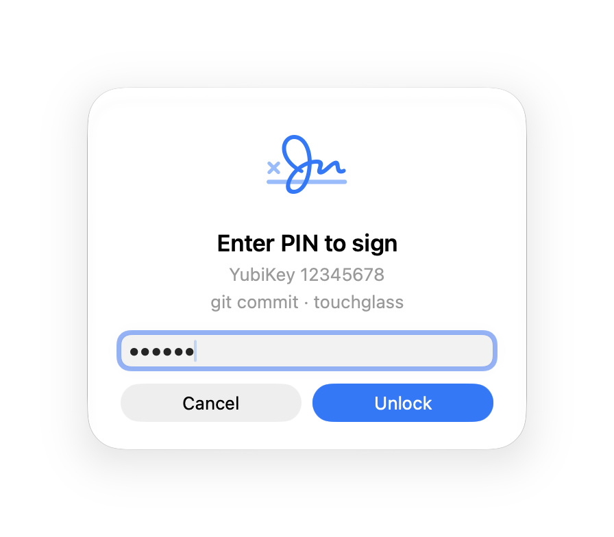
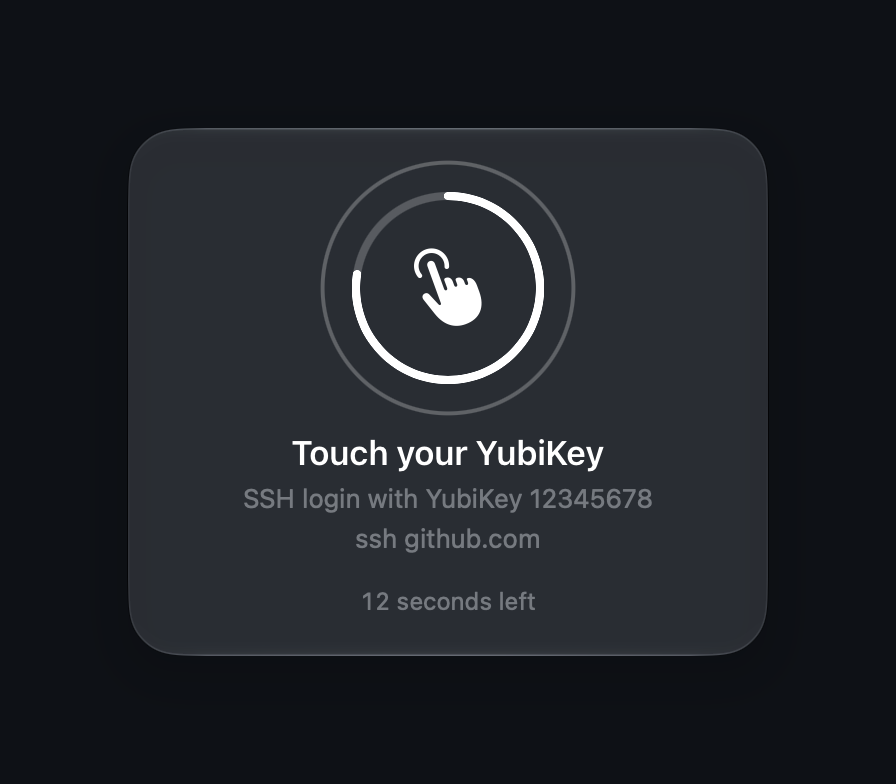
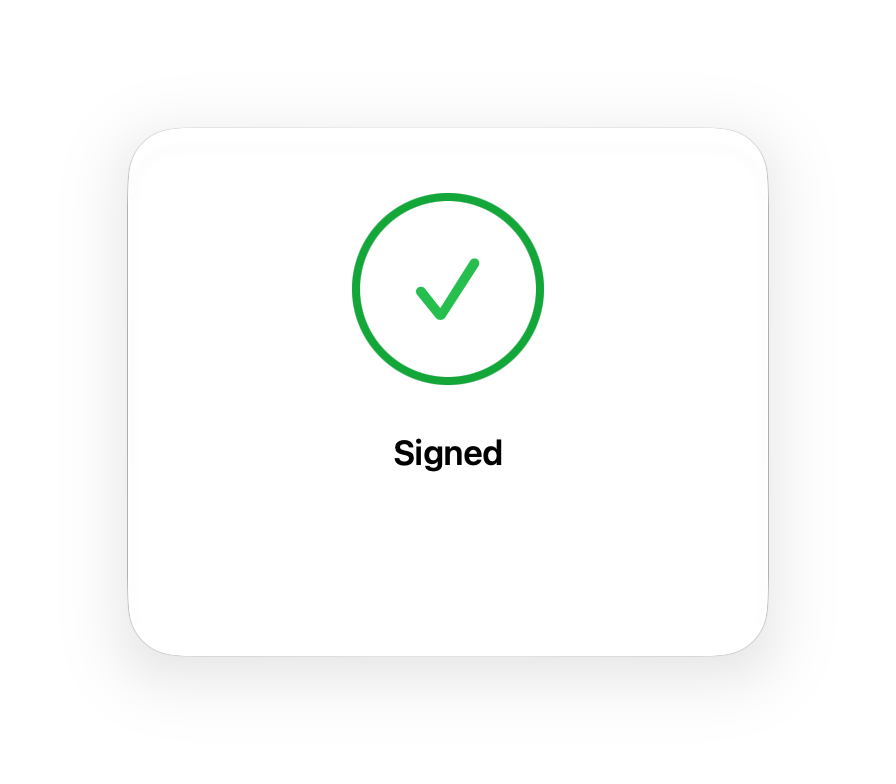

# TouchGlass

TouchGlass puts the PIN prompt and the touch prompt of your YubiKey in one floating macOS panel, for every commit signature, SSH login and decryption that goes through GnuPG.

<p>


</p>
<p>


</p>

When a card operation needs you, the panel asks for the PIN, then shows "Touch your YubiKey" with a countdown to the card's 15-second touch timeout. Under the title, it names the command that asked, such as `git commit · touchglass` or `ssh github.com`. After the card answers, the panel confirms and closes itself. It also asks for the passphrases of keys that aren't on a card.

If the TouchGlass app isn't available, prompts go to `pinentry-mac` and card operations work as before, without the panel. Installing TouchGlass changes nothing in GnuPG until you apply the change to `gpg-agent.conf`.

## Requirements

- macOS 26 or later, on Apple silicon or Intel.
- GnuPG. Homebrew installs it with TouchGlass.
- A YubiKey with OpenPGP keys that GnuPG uses.

## Install

```sh
brew install ambroos/touchglass/touchglass
touchglass install
```

`touchglass install` sets up TouchGlass's files in `~/Library/Application Support/TouchGlass` and prints the two lines to change in `gpg-agent.conf`. To have it make the change and restart gpg-agent, preview the edit and then apply it:

```sh
touchglass install --apply --dry-run
touchglass install --apply
```

`--apply` backs up `gpg-agent.conf` first. gpg-agent forgets its cached PINs when it restarts, so the next card operation asks for the PIN again. `brew upgrade touchglass` needs no new `touchglass install`.

TouchGlass times the touch prompt by your YubiKey's touch policy, which it reads from the card without a PIN or a touch. To see what it learned, or to read the card again after you change a policy, run `touchglass card`.

Without Homebrew, download the notarized `TouchGlass-<version>.zip` from the [TouchGlass releases on GitHub](https://github.com/ambroos/touchglass/releases), move `TouchGlass.app` to `/Applications`, and run `/Applications/TouchGlass.app/Contents/Resources/touchglass install`.

## Uninstall

Restore `gpg-agent.conf` first, then remove the formula:

```sh
touchglass uninstall --apply
brew uninstall touchglass
```

## Learn more

- [Install and uninstall in detail](docs/install.md): what each command changes, upgrades, and troubleshooting.
- [Configure TouchGlass](docs/configuration.md): the panel's look, sounds, the touch countdown, your card's touch policies and the fallback pinentry.
- [How touchglass-scdaemon works](docs/touchglass-scdaemon.md): the proxy between gpg-agent and scdaemon.
- [Contribute to TouchGlass](CONTRIBUTING.md): build from source, run the tests and the demo, and publish a release.

## License

Apache License 2.0. See [LICENSE](LICENSE).
